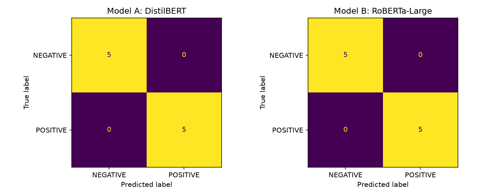
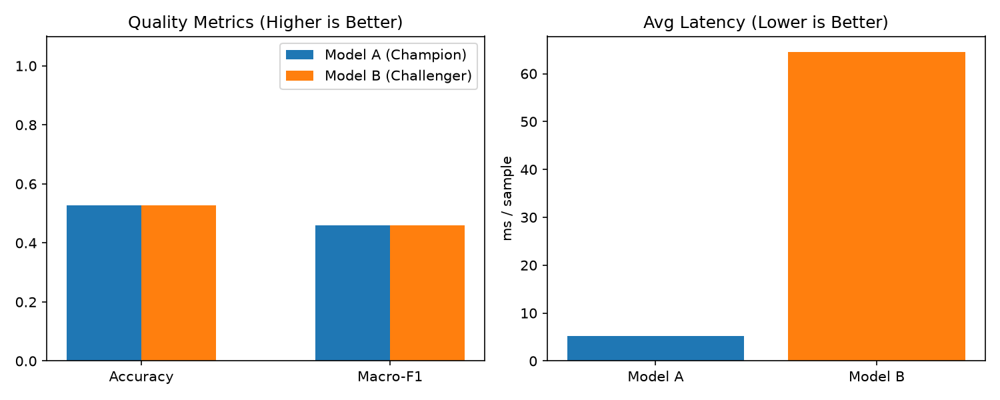

# MLflow Champion–Challenger Evaluation: Sentiment Analysis

- **Student USN:** `1MS25CI012`
- **Task:** Binary Sentiment Classification (`POSITIVE` / `NEGATIVE`)
- **MLflow Experiment:** `hf-sentiment-champion-challenger`
- **Registered Model Name:** `sentiment-model`

---

## 1. Project Overview

This repository implements an end-to-end **Champion–Challenger** model evaluation, registration, and inference workflow using **Hugging Face Transformers** and **MLflow**:

1. **Automated Evaluation & Tracking (`evaluate.py`):** Evaluates a lightweight baseline model (Champion) against a larger transformer model (Challenger) on a labeled evaluation dataset, wraps both models as custom `mlflow.pyfunc.PythonModel` artifacts, logs parameters, metrics, tags, and diagnostic plots to MLflow, and executes an automated comparison run (`compare_sentiment`).
2. **Model Registry & Alias Promotion (`register_champion.py`):** Reads the comparison decision, registers both candidate models under `sentiment-model` in the MLflow Model Registry, tags each version with its Hugging Face model ID and role, and assigns `@champion` and `@challenger` aliases.
3. **Decoupled Production Inference (`predict_from_mlflow.py`):** Loads the active production model strictly via `models:/sentiment-model@champion`—without hardcoding run IDs or importing `transformers` directly—and generates predictions on unseen data.

---

## 2. Repository Structure

```text
1MS25CI012-mlflow-champion-challenger/
├── data/
│   ├── eval_inputs.csv              # 10 labeled evaluation sentences (text, label)
│   └── new_data.csv                 # 8 unseen test sentences for inference
├── outputs/
│   ├── confusion_matrices.png       # Side-by-side confusion matrices (Model A vs B)
│   ├── model_comparison.png         # Quality metrics & latency comparison chart
│   ├── disagreements.csv            # Sample-level prediction comparison
│   ├── metrics_summary.json         # Consolidated metrics and winner decision
│   ├── predictions_A.csv            # Model A evaluation outputs & confidence scores
│   ├── predictions_B.csv            # Model B evaluation outputs & confidence scores
│   └── new_data_predictions.csv     # Inference results from @champion model
├── evaluate.py                      # Experiment runner, PyFunc wrapper, & comparator
├── register_champion.py             # Model Registry registration & alias assignment
├── predict_from_mlflow.py           # Registry-based inference script
├── requirements.txt                 # Python dependencies
└── README.md                        # Project documentation & results
```

---

## 3. Models Evaluated

| Role | Run Name | Hugging Face Model ID | Architecture | Device |
| :--- | :--- | :--- | :--- | :--- |
| **Model A (Champion)** | `A_sentiment_distilbert-sst2` | `distilbert-base-uncased-finetuned-sst-2-english` | DistilBERT (66M params) | CPU |
| **Model B (Challenger)** | `B_sentiment_roberta-large` | `siebert/sentiment-roberta-large-english` | RoBERTa-Large (355M params) | CPU |

**Shared Evaluation Configuration:**
- `task`: `sentiment-classification`
- `max_length`: `512`
- `batch_size`: `8`
- `eval_samples`: `10`
- `seed`: `42`

---

## 4. Evaluation Results & Selection Decision

### Quantitative Metrics

| Metric | Model A (`distilbert-sst2`) | Model B (`roberta-large`) | Delta (`B - A`) |
| :--- | :---: | :---: | :---: |
| **Accuracy** | `1.0000` | `1.0000` | `0.0000` |
| **Precision (Macro)** | `1.0000` | `1.0000` | `0.0000` |
| **Recall (Macro)** | `1.0000` | `1.0000` | `0.0000` |
| **Macro-F1 (Primary)** | `1.0000` | `1.0000` | `0.0000` |
| **Avg Latency (ms/sample)** | **`6.10 ms`** | `60.22 ms` | `+54.12 ms` (`9.87x`) |

### Decision Rule & Outcome

- **Primary Metric:** `macro_f1` (higher is better), requiring a minimum improvement margin of `+0.02` for promotion.
- **Latency Guardrail:** Challenger is rejected if inference latency exceeds `5.0x` the Champion's latency.
- **Tie-Breaker:** If quality scores fall within the margin, retain the faster model (`avg_latency_ms`).
- **Winner:** **Model A (`distilbert-base-uncased-finetuned-sst-2-english`)**
- **Decision Reason:** Both models achieved `1.0000` Macro-F1 on the evaluation set (`delta = 0.0000 < 0.02`), while Model B was `9.87x` slower (`60.22 ms` vs `6.10 ms`). Model A was retained as `@champion` (`v1`) and Model B was registered as `@challenger` (`v2`).

### Evaluation Plots





---

## 5. Setup & Reproduction Steps (Windows PowerShell)

### 1. Environment Setup
```powershell
python -m venv .venv
.\.venv\Scripts\Activate.ps1
python -m pip install -r requirements.txt
```

### 2. Start Local MLflow Tracking Server (Terminal 1)
*(Note: `DISABLE_SQLALCHEMY_CEXT="1"` avoids Windows Application Control DLL blocks on SQLAlchemy C-extensions.)*
```powershell
\$env:DISABLE_SQLALCHEMY_CEXT="1"
python -m mlflow server --host 127.0.0.1 --port 5000
```

### 3. Run Evaluation, Registration, and Inference (Terminal 2)
```powershell
# Step 1: Evaluate both models and log comparison artifacts
python evaluate.py

# Step 2: Register models and assign @champion / @challenger aliases
python register_champion.py

# Step 3: Run blind inference using models:/sentiment-model@champion
python predict_from_mlflow.py
```